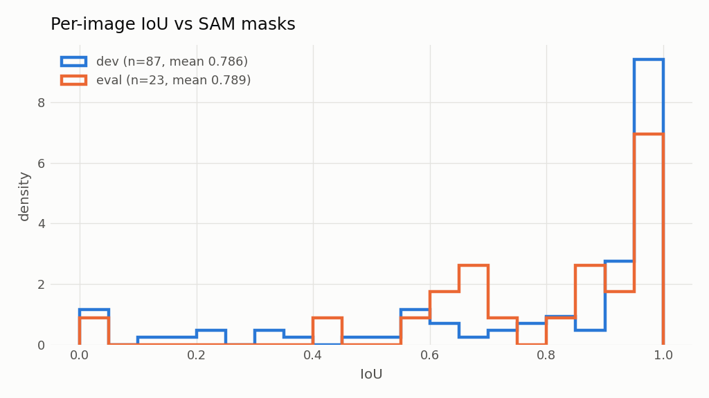
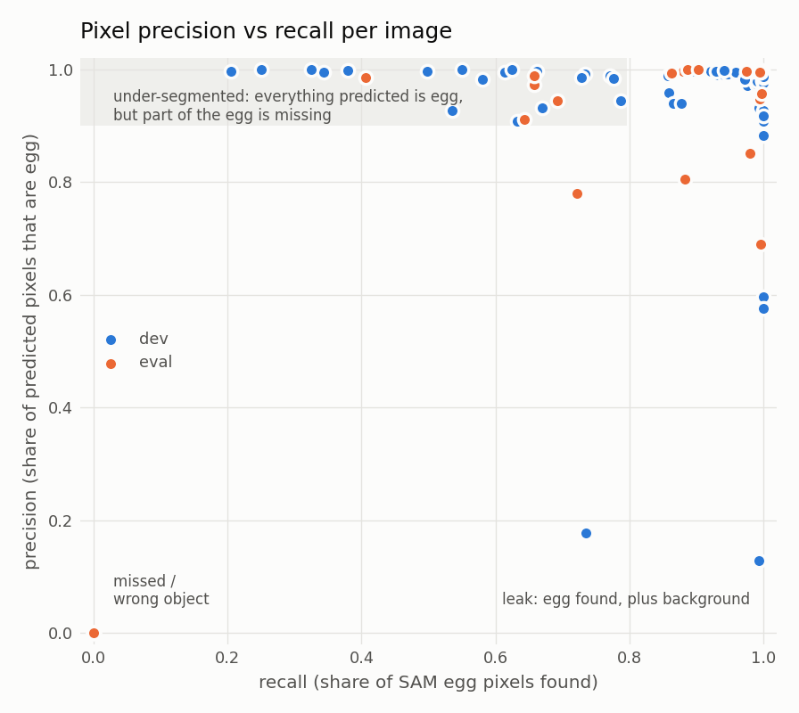
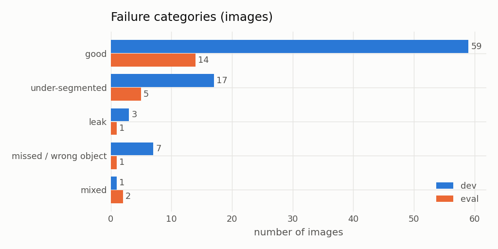
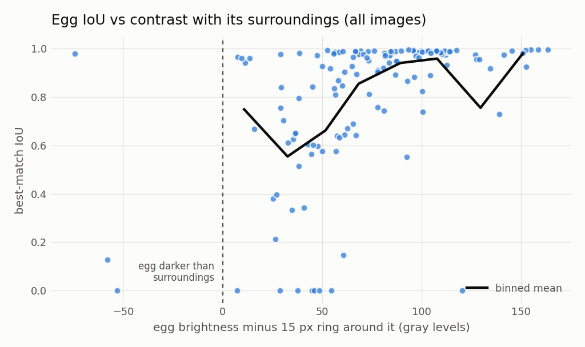
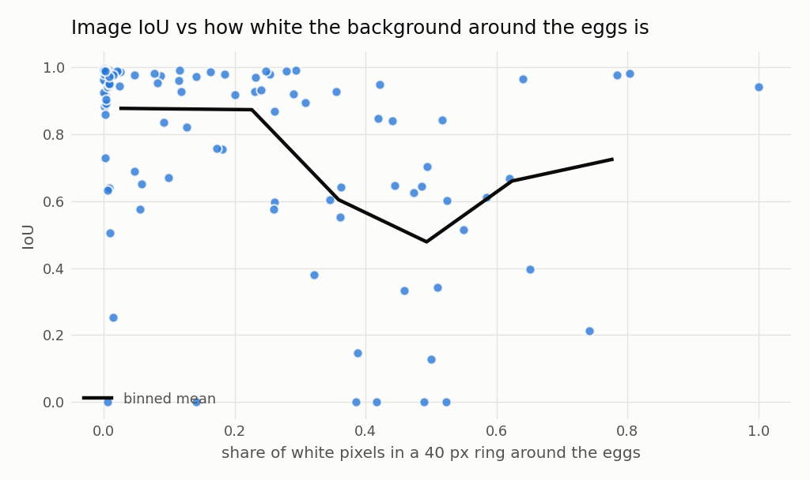
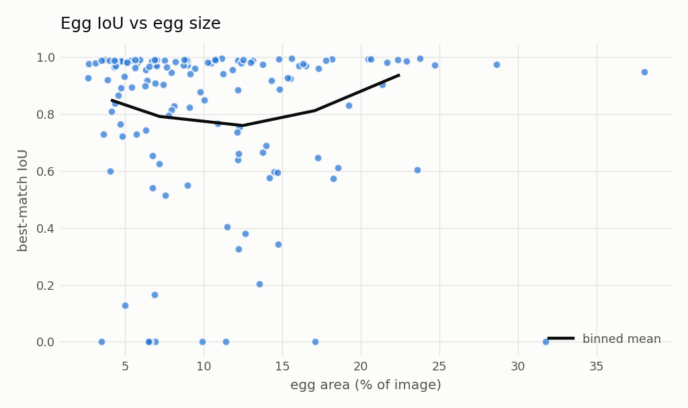
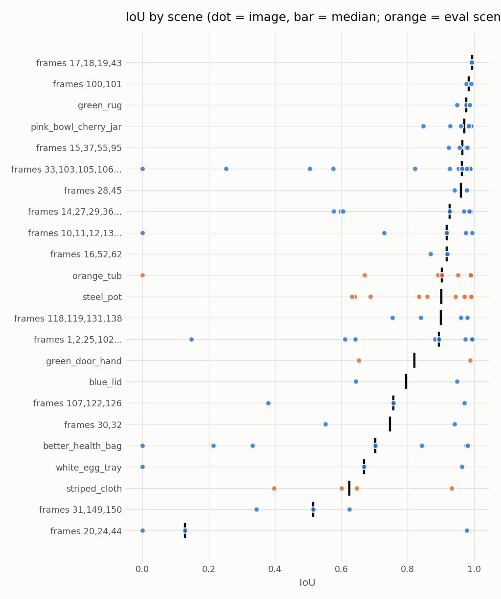
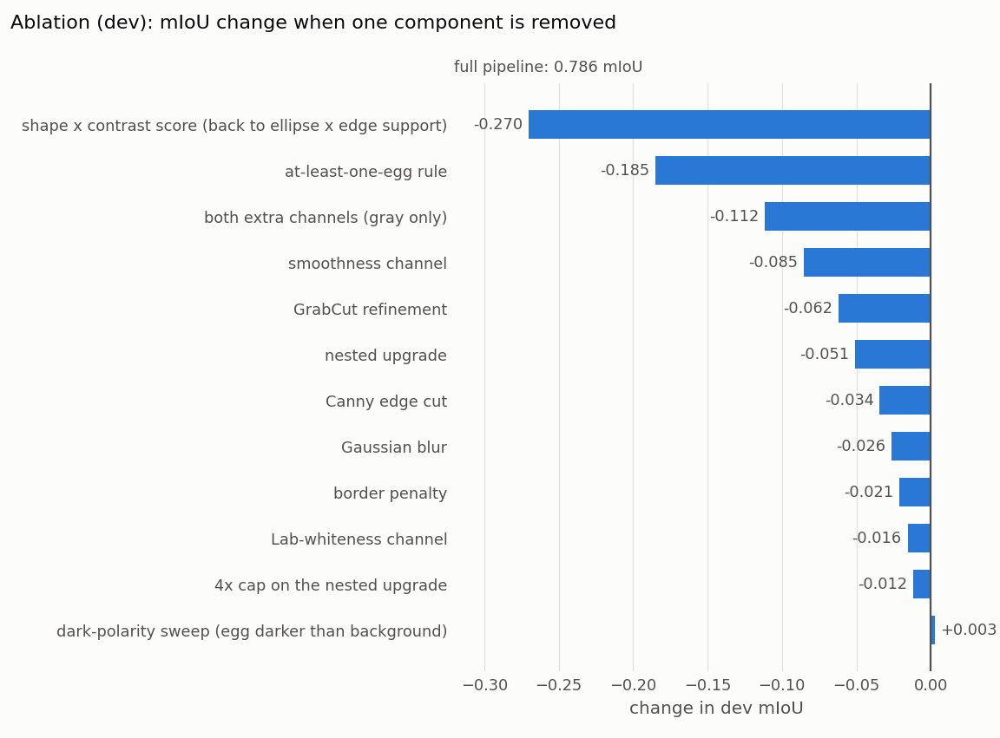
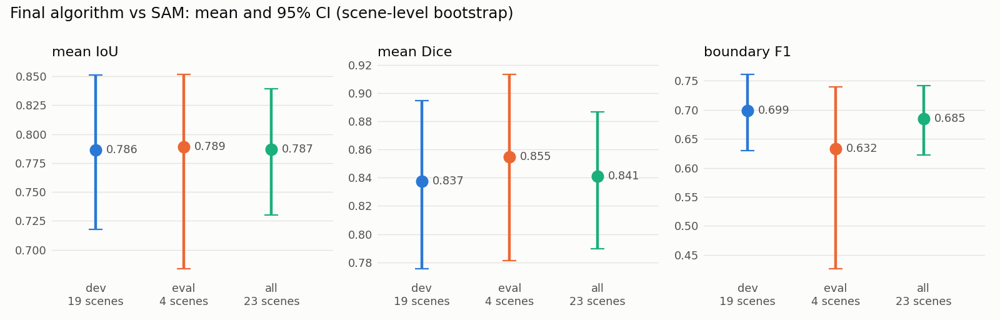
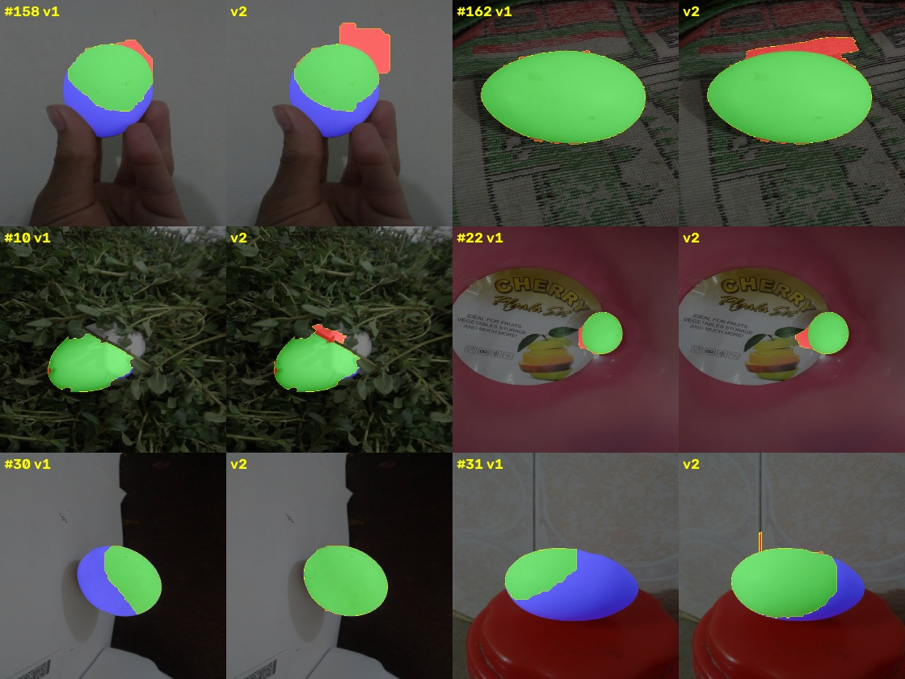

# Task 3: Evaluation and analysis

**Ground truth**: the Task 1 SAM masks (`outputs/sam_masks`). **Predictions**: the final classical algorithm,
`configs/t16_nest_cap4.yaml` (`outputs/cv_masks`). The algorithm was frozen after the dev experiments and run on the
eval split once. Everything here is produced by `python src/evaluate.py`.

GrabCut's random initialisation is seeded per image, so results don't depend on processing order. The numbers
below come from that seeded run; the unseeded run gave 0.785 dev and 0.788 eval mIoU, so within ±0.002.

## 1. Quantitative results

| Metric | dev (87 img, 110 eggs) | **eval (23 img, 28 eggs)** |
|---|---|---|
| mean IoU | 0.786 | **0.789** |
| mean Dice | 0.837 | **0.855** |
| pixel precision | 0.895 | **0.905** |
| pixel recall | 0.828 | **0.830** |
| boundary F1 (3 px tolerance) | 0.699 | **0.632** |
| HD95, median (px) | 16.8 | **24.0** |
| instance F1 (Hungarian matching, IoU ≥ 0.5) | 0.885 | **0.929** |
| correct egg count | 97.7% | **100%** |

**Why these metrics:**
- **IoU and Dice** measure overall mask agreement.
- **Precision and recall** say *which way* a mask is wrong: too much, or too little.
- **Boundary F1 and HD95** measure contour quality, which region overlap hides.
- **Instance F1 and count accuracy** check that each egg is found as a separate object, which matters for tracking in Task 4.

**Dev vs eval:** eval matches dev (0.789 vs 0.786 mIoU). Despite 27 tuning trials on dev, the algorithm did not overfit
to the dev scenes. Two caveats:
- **Small, correlated eval set:** eval is only 4 scenes and 23 images, so its mean has wide error bars. A single
  image (#139) costs it 0.04 mIoU.
- **Boundaries are where eval is weaker:** boundary F1 is 0.632 on eval vs 0.699 on dev. The eval scenes (steel pot
  with water, striped cloth) have reflective or patterned surroundings, which make the contours less exact.

Across all 138 eggs, 88% are matched with IoU ≥ 0.5. Mean HD95 is far higher than the median (59 vs 17–24 px)
because a few complete misses dominate it.

## 2. Where the error comes from

Each image is put into one category from its pixel precision P and recall R:
- **good:** IoU ≥ 0.8.
- **under-segmented:** P ≥ 0.9 and R < 0.8.
- **leak:** P < 0.75 and R ≥ 0.75.
- **missed / wrong object:** R < 0.3.
- **mixed:** everything else.

| Category | images (dev + eval) | share of all lost IoU |
|---|---|---|
| good | 73 | 15% |
| **under-segmented** | 22 | **38%** |
| missed / wrong object | 8 | 32% |
| leak | 4 | 9% |
| mixed | 3 | 6% |

 

**The dominant error is under-segmentation, not false detections.** The precision-vs-recall plot shows it: most
imperfect images sit in the top-left band. Almost everything predicted is egg, but part of the egg is missing.

## 3. What makes an image hard

**1. Contrast with the surroundings is the main driver** (Spearman ρ = 0.59 between egg IoU and contrast,
p = 4·10⁻¹⁴). Contrast here is egg brightness minus a 15 px ring around it.

| Contrast | eggs | mean IoU |
|---|---|---|
| ≥ 50 gray levels | 102 | 0.89 |
| 0–50 | 33 | 0.56 |
| < 0 (backlit: egg darker than background) | 3 | 0.37 |

**2. Partly white backgrounds are hardest.**

| Background (share of white pixels in a 40 px ring around the eggs) | images | mean IoU |
|---|---|---|
| < 20% white | 66 | 0.88 |
| 20–60% white | 37 | 0.63 |
| > 60% white | 7 | 0.75 |

Fully white surroundings do a bit better, probably because the egg's shadow then gives a clean edge.

**3. Touching eggs:** they score lower (0.68 vs 0.82 mean IoU, 13 eggs). The shared boundary has little contrast.
Images with several eggs still average higher (0.884 vs 0.769), because most of them are on the high-contrast marble
counter.

**4. Egg size has no clear effect** (mean IoU 0.77–0.86 across size bins).

**5. By scene:** the worst scenes are:

| Scene | images | mean IoU |
|---|---|---|
| eggs held against a bright wall (#20, #24, #44) | 3 | 0.37 |
| red lid / steel tray | 3 | 0.49 |
| white egg tray | 3 | 0.54 |
| "Better Health" bag | 7 | 0.58 |

## 4. Qualitative analysis: what went wrong

**Under-segmented** (`gallery_under_segmented.jpg`)

In #109, #31, #126, #5 and #142, the prediction stops at the **line between the lit and shadowed sides of the egg**.
A white egg under one-sided light has two very different brightness levels. At every threshold in the sweep the two
halves are separate blobs, and the lit half alone is already a good ellipse, so it gets picked. GrabCut then can't
cross into the shadowed half, because its colour model learned "egg = bright".

The nested-upgrade step (t11) fixes this only when some candidate covers both halves.

**Missed / wrong object** (`gallery_missed.jpg`)

| Cause | Images | What happens |
|---|---|---|
| White on white | #106, #125 | Egg and bag have the same brightness and no texture difference. The edge between them is too weak, so no threshold isolates the egg. The forced pick (at least one egg per image) then lands on a patch of bag. |
| Occlusion | #11, #117 | A twig or the tray rod cuts the egg into pieces, and none of the pieces is egg-shaped on its own. |
| Close-up held egg | #44 | The egg fills most of the frame and merges with the bright background at every threshold. |
| Edge of the frame | #139 (eval) | The egg is cut by the image edge against a light wall, and the forced pick lands on the tub rim. |

**Leak** (`gallery_leak.jpg`): the egg itself is found completely (recall 0.9–1.0), but the mask also takes in
some background.

| Cause | Images | What happens |
|---|---|---|
| Backlit egg in a hand | #20 | The selected dark blob is egg plus hand. GrabCut can't fix a wrong starting region. (#155 is similar but scores as "mixed".) |
| Ash-covered eggs | #27, #78 | The grey, ash-dusted top of the egg looks like the ash heap, so GrabCut spreads into the heap. |
| Reflective steel and water | #159 (eval) | Bright reflections next to the egg join the mask. (#145 is similar but scores as "mixed".) |

**Backlighting doesn't always fail:** #24 is backlit and scores 0.98, because the egg is a clean dark ellipse against
the bright wall. It fails when the dark egg touches an equally dark hand (#20) or fills the frame (#44).

## 5. Performance gaps and potential improvements

| Gap | Evidence | Improvement |
|---|---|---|
| Lit/shadow split on one egg | 38% of lost IoU; recall 0.6 with precision ≈ 1 | Normalize the lighting before the sweep: divide by a large-blur estimate of the illumination, or use chromaticity (r, g), which ignores shading. Or **merge neighbouring candidates whose union fits one ellipse better** than either part. |
| Low-contrast, white-on-white eggs | IoU 0.56 at contrast < 50 | Use the egg's own **shadow** as a cue (a dark crescent beside a bright blob), or add a gradient-based ellipse detector (e.g. randomized Hough on Canny edges) that doesn't depend on region thresholds. |
| Occlusion | #11, #117 | Fit an ellipse to *several* nearby egg-coloured pieces together (a RANSAC ellipse over their outline points). |
| Forced pick lands on background | #106, #125, #139 | Keep the at-least-one-egg rule (t14 showed dropping it costs 0.17 mIoU), but rank the forced pick by a stricter shape test than the normal threshold. |
| GrabCut leaking into skin, ash or reflections | #20, #27, #78, #145, #159 | Add a skin-colour model (YCrCb range) as GrabCut background seeds. Reject refinements that make the mask less elliptical (t15 tried this with fixed thresholds and saw no effect, because the main leaks then came from selection; after the t16 cap it is worth retrying). |
| Boundary accuracy | boundary F1 0.64–0.70 | Fit active contours (snakes) or an ellipse to the final mask, scored against the image gradient. |

**Limitation of the ground truth:** SAM's masks are not perfect labels. For #117 they needed manual prompts, and in
#123 and #125 SAM leaves out the part of the egg hidden behind paper. In a few images the classical method is marked
wrong where SAM itself is unsure. The numbers above measure agreement with SAM, not with hand-drawn labels.

## 6. Robustness: ablation, uncertainty and runtime

### 6.1 Ablation: what each component contributes (dev)
`python src/ablation.py` runs the final pipeline with one component removed at a time, on all 87 dev images.
"Worse" and "better" count images whose IoU changes by more than 0.05.

| Component removed | dev mIoU | change | boundary F1 | images worse / better |
|---|---|---|---|---|
| none (final pipeline) | 0.786 | | 0.699 | |
| shape² × contrast score (back to ellipse × edge support) | 0.516 | **−0.270** | 0.467 | 54 / 1 |
| at-least-one-egg rule | 0.601 | −0.185 | 0.556 | 25 / 0 |
| both extra sweep channels (gray only) | 0.675 | −0.112 | 0.583 | 27 / 0 |
| smoothness channel | 0.701 | −0.085 | 0.605 | 22 / 1 |
| GrabCut refinement | 0.724 | −0.062 | **0.462** | 43 / 0 |
| nested upgrade | 0.736 | −0.051 | 0.652 | 19 / 1 |
| Canny edge cut | 0.752 | −0.034 | 0.659 | 17 / 3 |
| Gaussian blur | 0.760 | −0.026 | 0.679 | 11 / 7 |
| border penalty | 0.766 | −0.021 | 0.683 | 5 / 0 |
| Lab-whiteness channel | 0.771 | −0.016 | 0.687 | 4 / 0 |
| 4× cap on the nested upgrade | 0.774 | −0.012 | 0.691 | 3 / 1 |
| dark-polarity sweep | 0.789 | **+0.003** | 0.703 | 0 / 1 |

- **The candidate score matters most.** Selection, not region generation, was the bottleneck: the egg is usually
  among the candidates, and the score decides whether it wins (see the generation/selection diagnosis in the
  experiment log).
- **Smoothness is the most useful channel.** On its own it is worth most of the 0.112 that the two extra
  channels add together.
- **GrabCut is mostly about boundaries.** It adds 0.062 mIoU but 0.237 boundary F1.
- **The dark-polarity sweep adds nothing.** It was meant for backlit eggs, but once the smoothness channel was
  added it became redundant, and removing it is slightly better and 12% faster. The frozen final model keeps it,
  because changing the model after the eval run would be tuning on information from eval; a simplified version
  would have to be validated again.

### 6.2 How certain are the numbers?
Images of the same scene are strongly correlated (same background, lighting and eggs), so `python src/stats.py`
resamples whole **scenes** (cluster bootstrap, 10,000 resamples) rather than single images.

| | images / scenes | mIoU [95% CI] | Dice [95% CI] | instance F1 [95% CI] |
|---|---|---|---|---|
| dev | 87 / 19 | 0.786 [0.718, 0.851] | 0.837 [0.775, 0.894] | 0.885 [0.790, 0.940] |
| **eval** | 23 / 4 | **0.789 [0.683, 0.852]** | 0.855 [0.781, 0.913] | 0.929 [0.789, 1.000] |
| all | 110 / 23 | 0.787 [0.730, 0.839] | 0.841 [0.790, 0.887] | 0.894 [0.819, 0.942] |

**Scene-grouped folds:** splitting all 110 images into 5 folds by scene gives fold mIoUs of 0.752, 0.771, 0.791,
0.718 and 0.902 (**0.787 ± 0.070**). No parameters are re-fitted per fold, so this measures how much the result
depends on *which scenes* are evaluated, not on tuning.

**What this means:**
- **Dev and eval agree:** 0.786 vs 0.789, well inside each other's intervals.
- **The eval interval is wide** (about ±0.08), because it is only 4 scenes. Even the scene bootstrap is rough
  with that few clusters.
- **The scene matters more than the last tuning steps.** Which scenes are tested moves mIoU by ±0.07, while each
  of the last few trials changed it by about 0.01. Those late gains are real on dev, which the paired
  image-level ablation shows, but they are small next to scene variation.

### 6.3 Runtime
| Method | Hardware | Time per image |
|---|---|---|
| SAM ViT-H + Grounding DINO (Task 1) | Kaggle T4 GPU | 2.6 s (289 s for 110 images, including writing overlays) |
| Classical, final pipeline | 1 CPU thread (Intel laptop) | 4.4 s (median 4.3, max 7.4) |
| Classical, without GrabCut | 1 CPU thread | 2.4 s |
| Classical, without the dark-polarity sweep | 1 CPU thread | 3.8 s |

The classical method needs no GPU and no model weights, and frames are independent, so it parallelizes across
cores: the video tracking runs it on 4 Kaggle CPU cores. GrabCut is 45% of its time. The 24-level threshold sweep
(×3 channels, plus one extra polarity) is most of the rest; fewer levels would be the first thing to cut for speed.

## 7. A follow-up experiment after the frozen evaluation: ellipse completion (v2)

The model above (v1, `t16_nest_cap4`) was frozen and evaluated on eval once. Afterwards, I tried to fix its
largest failure: eggs cut along the lit/shadow line, 38% of all lost IoU. **All design work used dev only**, and v2
was then run on eval **once**. Because this came after eval had already been seen, the v2 eval number is
reported separately and is **not** the submitted result.

**Diagnosis (dev):** for the 31 dev eggs cut by a boundary inside the true egg, only **4%** of the cut's outline
points lie on a Canny edge, against 25% of the real outline. The soft shading gradient makes few edges, while the
egg's silhouette makes strong ones.

**Method:** before GrabCut, each selected blob is "completed":
1. **Support points:** take the outline points whose gradient is strong *for this blob* (≥ 0.3 × the 90th
   percentile along its own outline).
2. **Fit:** fit an ellipse to those points.
3. **Add:** add the ellipse to the blob, keeping only added pixels about as colourless as the egg.
4. **Guards:** at least 20 support points, the ellipse must contain the blob, growth ≤ 2.5×, aspect ratio ≤ 2.5,
   no overlap with another egg.

GrabCut then refines the completed egg.

| Trial (dev) | dev mIoU | boundary F1 | instance F1 | decision |
|---|---|---|---|---|
| t16 (v1) | 0.786 | 0.699 | 0.885 | frozen v1 |
| t17a: support = Canny pixels | 0.791 | 0.700 | 0.885 | discard: fires on only 24/87 images, because the whole outline is faint on pale backgrounds |
| t17b: support = relative gradient | 0.808 | 0.730 | 0.903 | keep |
| t17c: + chroma limit on added pixels | **0.809** | **0.732** | **0.903** | v2: 3 images worse instead of 4 (fixes leaves #10, rug #162) |
| t17b without GrabCut | 0.754 | 0.472 | 0.866 | completion and GrabCut are complementary |

**Eval (run once):**

| | mIoU | Dice | boundary F1 | instance F1 |
|---|---|---|---|---|
| v1 | **0.789** | 0.855 | 0.632 | **0.929** |
| v2 | 0.786 | 0.852 | 0.624 | 0.893 |

| Eval scene | v1 | v2 |
|---|---|---|
| green door + hand | 0.822 | **0.886** |
| striped cloth | 0.633 | 0.645 |
| orange tub | 0.769 | 0.777 |
| steel pot (9 images) | **0.858** | 0.829 |

**Interpretation:**
- **The fix works where it was aimed.** v2 improves the 3 eval scenes that have lit/shadow splits (#160: 0.65 →
  0.78).
- **The steel pot gets worse.** There, the completed ellipse extends onto the bright, colourless reflections and
  bubbles of the water next to the egg. The chroma limit can't tell them apart from a shadowed egg side. #145 and
  #135 fall below IoU 0.5, which is the instance-F1 drop.
- **Dev didn't predict this.** Dev has no boiling-water scene with reflections like these, so the side effect was
  invisible there.
- **Overall the difference is within noise.** The eval mean is unchanged (0.786 vs 0.789, far inside the ±0.08 CI).

**Decision:** v1 stays the submitted model. Tuning v2 against the steel-pot images would mean designing on eval. A
fair next step is a reflection test (reflections are much brighter than the egg and form specular highlights),
developed on scenes like it outside this eval set. This experiment also shows why the scene-grouped split
matters: a random split would have put steel-pot images in dev, the guard would have been tuned on them, and the
eval number would have looked better than the method deserves.
