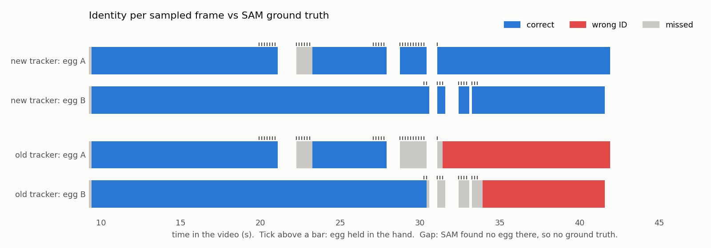

# Task 4: Quantitative tracking evaluation

## Ground truth
- **Masks:** [`notebooks/task4_video_gt_kaggle.ipynb`](../../notebooks/task4_video_gt_kaggle.ipynb) runs the
  Task 1 pipeline (Grounding DINO `"an egg."` + SAM ViT-H) on **every 4th frame of the egg scene** (frames
  222–1004, 196 frames, 640×360). This ground truth is independent of the classical detector the tracker uses.
- **Identities:** [`src/build_video_gt.py`](../../src/build_video_gt.py) assigns each SAM egg to **A** (raw egg)
  or **B** (boiled egg). It uses rules written down from a frame-by-frame viewing of the video (the 30 s handover
  close-ups are in `outputs/tracking_debug/`). Every sampled frame was checked on `gt_review_0.jpg` and
  `gt_review_1.jpg`, which led to two rule fixes and one manual label.
- **Result:** 365 egg instances, **41 of them held in a hand**. 4 boxes are excluded because Grounding DINO put
  one box around both eggs and the hand.
- **SAM misses some eggs.** It doesn't find an egg lifted high in the hand near the shirt (frames 506–530,
  670–686) or the two eggs while one hand covers both (734–742). Those frames have no ground truth for that
  egg, so false positives are only counted in frames where the ground truth contains both eggs.

## Metrics ([`src/eval_tracking.py`](../../src/eval_tracking.py))
Per frame, predictions are matched to ground-truth eggs with Hungarian assignment on centroid distance divided by
the ground-truth box diagonal (a match needs < 0.5). Centroids are used rather than box IoU because a held egg is
only partly visible: its ground-truth box covers the visible part, while the tracker reports an egg-sized box.
- **MOTA:** 1 − (missed + false positives + ID switches) / ground-truth eggs.
- **ID switches:** the number of times an egg's matched track ID changes.
- **IDF1:** the share of the time each egg is labelled with *its own* ID (ground-truth and predicted tracks
  paired one-to-one). This is the metric that punishes a lasting swap.
- **MOTP:** mean normalized centroid distance of the matches.

The metrics are implemented in the script rather than taken from a library, and were checked on a synthetic
case with a known swap, a miss and a false positive.

## Results (the 1080p videos, evaluated at 640-px scale)
| Tracker | MOTA | IDF1 | ID switches | frames with the wrong ID | missed | false pos. | held: recall | held: IDF1 |
|---|---|---|---|---|---|---|---|---|
| **final (`tracked_eggs.mp4`)** | **0.962** | **0.953** | **0** | **0** | 8 | 6 | **0.854** | **0.921** |
| previous (swap at 30 s) | 0.882 | 0.620 | 2 | 109 (from frame 754) | 32 | 9 | 0.317 | 0.481 |

Both trackers were also re-run on the 360p video from the same cached detections, and the results are the same
to within 0.01.

**What the numbers say:**
- **The ID switch is gone.** IDF1 rises from 0.62 to 0.95. Zero ID switches were observed across the 196 sampled
  evaluation frames, and no sampled frame shows an egg with the other egg's ID. Identity continuity was also
  inspected frame by frame: `src/check_tracks.py` checks every frame in six segments before and after the handover,
  and the annotated video was checked by eye. The old tracker swaps A and B at the handover and keeps them swapped until the
  end (109 sampled frames from frame 754, the red bars).
- **Held eggs are now actually followed.** The tracker has a correct estimate for 85% of the held-egg frames
  (old: 32%), with mean position error 0.07 egg diagonals.
- **The remaining misses are explained:**
  - **Frame 222:** the first frame of the scene. A new track is confirmed after 3 detections, by design.
  - **Frames 534–554** (about 1 s): egg A is lowered to the table with the fingers over its top. The estimate
    follows the hand's knuckles by optical flow and sits about 105 px (one egg diagonal) directly above the egg,
    without locking onto the sliver of white below the fingers. The ID stays correct, and the egg is recovered
    when it is put down (frame 557).
- **On-table accuracy is near perfect:** recall 0.994 and IDF1 0.997.

**Caveats:**
- **The ground truth is SAM**, with identities from one person's viewing. It is not an independent second
  annotator.
- **The sampling is every 4th frame**, so a swap and swap-back within 4 frames would be missed. The per-frame
  checkpoints in `src/check_tracks.py` cover the full frame rate.
- **This is one video with two eggs.** IDF1 near 1 here says the occlusion handling works for this video, not
  that it would generalize to many identical objects crossing.
