# Egg Segmentation: SAM vs. Classical Image Processing, and Egg Tracking {.title}

CV Intern Task &nbsp;·&nbsp; {{AUTHOR}} &nbsp;·&nbsp; Code: <a href="https://github.com/Duggineniakhil/Egg_Segmentation">github.com/Duggineniakhil/Egg_Segmentation</a> &nbsp;·&nbsp; Tracking video: {{DRIVE_LINK}}

**Summary**

- **Task 1:** pseudo ground-truth masks for all 110 images from **Grounding DINO + SAM ViT-H**: 138 eggs, with 3
    images fixed by hand-written prompts.
- **Task 2:** a **scene-grouped 4:1 split** (87 dev / 23 eval images, 4 whole eval scenes) that measurably reduces
    leakage, and a fully classical segmenter developed over **30 logged trials**. The key steps were a multi-channel
    threshold sweep, an egg-shaped candidate score, a nested-candidate upgrade and GrabCut. Dev mIoU went from 0.339 to
    **0.786**.
- **Task 3:** on held-out eval, **mIoU 0.789 (95% CI 0.68–0.85), Dice 0.855, instance F1 0.929, 100% egg-count
    accuracy**. The main error is under-segmentation along an egg's lit/shadow line (38% of lost IoU). Also: an
    ablation, scene-level confidence intervals, and a follow-up experiment (v2) that fixes that error on dev but not
    on eval, reported as such.
- **Task 4:** the classical detector plus a tracker that follows eggs **through hand pick-ups** with optical flow.
    On 196 sampled frames scored against SAM ground truth: **MOTA 0.962, IDF1 0.953, and zero ID switches observed**.
    An earlier version swapped the two eggs at 30 s (IDF1 0.62); the cause and the fix are described.

Setup and the commands to reproduce every task are in the repository [README](https://github.com/Duggineniakhil/Egg_Segmentation#readme).

## Dataset
The Roboflow "egg" v1 dataset has **110 images (640×640)** of 1–4 white eggs on very different backgrounds: hands,
keyboards, leaves, ash, pink bowls, steel pots, white bags and egg trays. The export only sorts images into
classification folders, so there are **no box or mask labels**. Task 1 has to produce the masks from scratch.

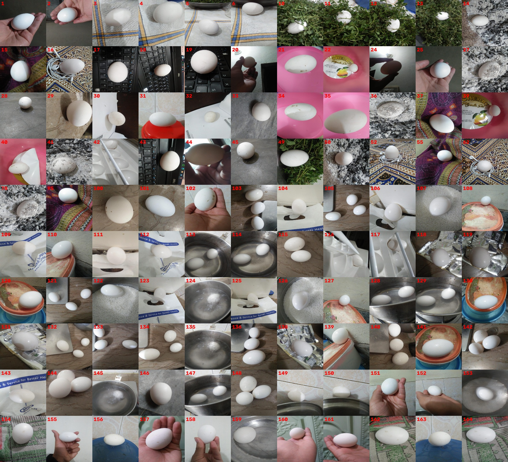

All 110 images. The same physical scene appears under non-consecutive file numbers (e.g. the steel pot: 113, 114, 124, 128, 129, 135, 145, 147, 153, 159).

# Task 1: Segmentation with a pretrained model
**Pipeline** ([`notebooks/task1_sam_kaggle.ipynb`](https://github.com/Duggineniakhil/Egg_Segmentation/blob/main/notebooks/task1_sam_kaggle.ipynb), Kaggle T4 GPU):

1. **Boxes:** Grounding DINO (base), an open-vocabulary detector, finds eggs with the text prompt `"an egg."` (box
    threshold 0.35, text threshold 0.25).

2. **Box cleanup:**
    - NMS (IoU 0.5).
    - Boxes under 0.2% of the image are dropped.
    - "Group" boxes are dropped: boxes containing ≥ 2 other boxes, which Grounding DINO often adds around a cluster
        of eggs.

3. **Masks:** SAM ViT-H is prompted with each box.
4. **Mask cleanup:**
    - Pieces smaller than 15% of the largest piece are dropped. The large pieces are all kept, because an occluder
        can split one egg.
    - Holes are filled.
    - Where masks overlap, a pixel goes to the mask with the higher SAM IoU prediction.

5. **Output:** an instance label map per image (`outputs/sam_masks/*.png`; 0 = background, 1…N = eggs).

**Review and fixes.** I checked every image on review sheets. 107 of 110 were correct on the first run. Three needed
hand-written prompts, recorded as `manual` in the meta files:

- **105 and 134:** an egg in shadow was missed (its box scored just under the threshold). Lowering the threshold
    everywhere would have added false boxes elsewhere, so I added one box each.
- **117:** an egg in a tray cup is split by a rod. SAM picked the cup rim, so I added a box plus one positive click
    on each side of the rod.

The review also exposed a bug: the first mask cleanup kept only the largest piece, so the far side of an occluded
egg was dropped. Hence the "≥ 15% of the largest piece" rule above. The final result is **138 eggs** (93 images
with one egg, 6 with two, 11 with three).

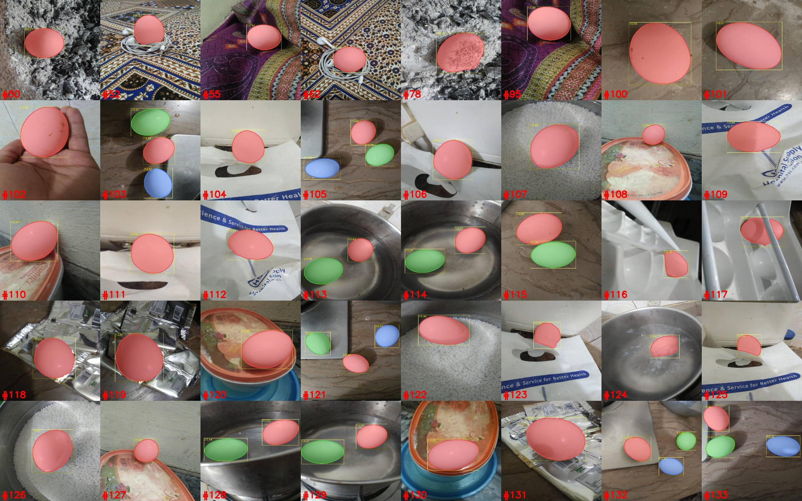

Part of the SAM review sheet (multi-egg images): boxes with detection score and instance masks.

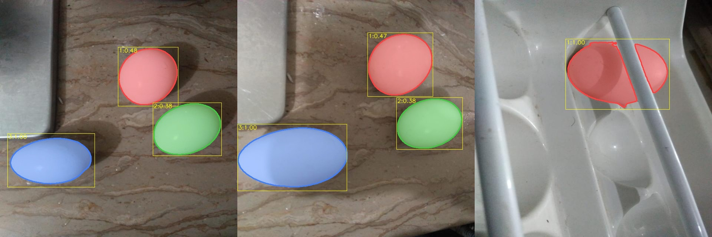

The three hand-fixed images: 105 and 134 (missed egg added), 117 (egg split by the tray rod).

**Limitation:** these masks are *pseudo* ground truth. In #123 and #125, SAM excludes the part of the egg hidden
behind paper, and #117 has a small spike. All later "errors" are disagreement with SAM, not with a human.

# Task 2: Segmentation with classical image processing

## 2.1 Leakage-aware dev/eval split
**The leakage problem.** Leakage here comes from **scenes**, not augmentation (Roboflow applied none). The images are
photos of about two dozen physical setups taken from slightly different angles. A random split would put
near-copies of a scene in both dev and eval, so eval would mostly measure whether the method remembers a
background.

**Method** ([`src/make_split.py`](https://github.com/Duggineniakhil/Egg_Segmentation/blob/main/src/make_split.py)):

1. **Inpaint the eggs out** using the SAM masks. All eggs look alike, so they would pull unrelated scenes together;
    the background is what identifies a scene.

2. **Embed** each background with CLIP ViT-B/32.
3. **Cluster** with agglomerative clustering (cosine distance 0.15).
4. **Review by eye.** The clustering split some real scenes apart.
    - A coarser threshold only merged them after unrelated scenes had collapsed into a 47-image group.
    - Adding a colour histogram fixed one scene and broke others.

    So **9 scenes confirmed by eye were merged by hand** (`SCENE_OVERRIDES`, each commented).

5. **Assign whole scenes to eval:** a random search over scene subsets for about 20% of images and a similar share
    of multi-egg images.

| | dev | eval |
|---|---|---|
| images | 87 | 23 |
| scenes | 19 | 4 (steel pot, orange tub, striped cloth, green door + hand) |
| multi-egg images | 13.8% | 21.7% |

The split is 3.8:1 rather than exactly 4:1, because whole scenes can't be divided.

**Leakage check:** an eval image's mean highest CLIP similarity to any dev image is **0.859**, against **0.911** for
random image-level splits. Section 3.6 shows why this mattered.

## 2.2 Final algorithm (v1, `configs/t16_nest_cap4.yaml`)
All code is in [`src/classical_seg.py`](https://github.com/Duggineniakhil/Egg_Segmentation/blob/main/src/classical_seg.py),
with every stage set from a YAML config.

1. **Gaussian blur** (7×7).
2. **Threshold sweep instead of one threshold.** Thresholds are taken at 24 percentile levels on three channels:
    - **gray**, in both polarities;
    - **smoothness**: 255 − 8 × the local standard deviation in an 11×11 window. Eggs are smooth, while ash, leaves,
        cloth patterns and keyboards are textured.
    - **Lab whiteness**: lightness L − 2 × chroma.

    Each binary mask is **cut along Canny edges** (auto thresholds, σ 0.6), so an egg separates from a neighbour of
    similar brightness. Every connected blob is a candidate.

3. **Candidate filter:** egg-sized (1.5–50% of the image), solid (solidity ≥ 0.85), aspect ratio ≤ 2.5 and
    ellipse-like (IoU with its fitted ellipse ≥ 0.75).

4. **Candidate score:**

    > quality = shape² × min(1, contrast / 50) × 0.6 if touching the image border

    - *shape* rescales the ellipse IoU from [0.75, 0.97] to [0, 1].
    - *contrast* is the egg's mean gray minus a 12 px ring around it.

5. **Greedy non-overlapping selection,** at least 1 and at most 6 eggs. Each pick is **upgraded to the largest
    candidate that contains it**, if that candidate's quality is ≥ 0.3× the pick's and it is ≤ 4× larger. This
    replaces a bright cap with the whole egg.

6. **GrabCut refinement:** the eroded blob is sure foreground and a 30 px band around it is "unsure". Its random
    initialisation is seeded per image, so results don't depend on processing order.

On one CPU thread this takes 4.4 s per image (GrabCut 45%). SAM took 2.6 s per image on a T4 GPU.

## 2.3 Experiment log: how the trials led to the algorithm
Each trial is a config inheriting from its predecessor (`base:`), and states what changed and why. It was run on
**dev only** with `src/run_experiment.py`, which appends to `outputs/experiments/log.csv`. The full log is on the next
pages, including every discarded attempt. The main path was:

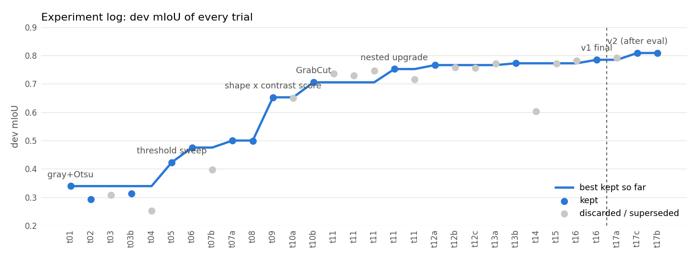

- **t01–t04: the limit of single thresholds.** Gray + Otsu gives 0.339 mIoU, finding eggs plus every bright patch
    (precision 0.37). Cleanup, whiteness and shape filters didn't help (0.25–0.31). On white or bright backgrounds the
    egg *merges* with the background into one blob, and a backlit egg is darker than its surroundings. **No single
    threshold separates them.** The shape filter raised instance precision to 0.81 while recall collapsed: what
    survives is an egg, but most eggs never become a blob.
- **t05: threshold sweep, both polarities** (0.423). Some threshold isolates the egg in many more images.
- **t06–t07: cutting the masks along Canny edges** separates eggs from similar neighbours (0.500). Loosening the
    shape filter (t07b) **hurt**: more junk candidates beat the eggs.
- **Diagnosis tools that shaped the next steps:**
    - **`src/diagnose_sweep.py`** measures the **oracle IoU**, the best IoU any candidate reaches. It shows whether a
        failure is in *generation* (no good candidate exists) or in *selection*. After t05, 42 of 50 failures were
        generation failures. After **t08 (smoothness channel)** the oracle rose from 0.67 to 0.78, but the final mIoU
        didn't move: **selection had become the bottleneck**.
    - **`src/analyze_candidates.py`** measures, over all dev candidates, how well each feature separates eggs
        (IoU ≥ 0.8 with SAM) from non-eggs (IoU < 0.3), as an AUC:

        | Feature | AUC |
        |---|---|
        | ellipse IoU | 0.976 |
        | ring contrast | 0.941 |
        | Canny edge support (the old score's main term) | only 0.702 |
        | old score | 0.760 |
        | **shape² × contrast × border penalty** | **0.988** |

- **t09: the new score** (0.652, count accuracy 0.98) was the biggest single step.
- **t10b: GrabCut** (0.705, boundary F1 0.43 → 0.62). Replacing blobs by fitted ellipses (t10a) didn't help.
- **t11: nested upgrade.** A loss breakdown showed that 51% of lost IoU was *partial* eggs (precision 0.96, recall
    0.61): a bright cap fits an ellipse slightly better than the whole egg. Upgrading to the containing candidate,
    with the ratio swept over 0.85, 0.7, 0.5, 0.3 and 0.15, peaked at 0.3 (0.752).
- **t12–t13:** a wider GrabCut band (0.766) and a Lab-whiteness channel (0.772). Two GrabCut growth limits were
    discarded, because they held back more partial eggs than the leaks they stopped.
- **t14–t16: three failed fixes that each explained something.**
    - **Not forcing an egg (t14):** −0.17, because many true eggs score low.
    - **Undoing implausible GrabCut growth (t15):** no effect, because the leaks happen *before* GrabCut.
    - **That led to t16:** capping the nested upgrade at 4× growth (0.785; #32: 0.08 → 0.94). This is the **frozen
        v1** model.

## 2.4 Ablation (dev, `src/ablation.py`)
Removing one component at a time from v1 confirms that the parts the log added are the ones that matter. The
**candidate score** matters most (−0.270), then the at-least-one-egg rule (−0.185) and the smoothness channel
(−0.085). GrabCut is worth 0.062 mIoU but 0.237 boundary F1. **The dark-polarity sweep adds nothing** (+0.003 when
removed; it was made redundant by the smoothness channel). It stays in the frozen model, because removing it after
evaluation would be tuning on eval information.

{{EXPERIMENT_LOG}}

Full experiment log (dev split). Trials t17a–c were run after the v1 evaluation (see 3.6).

# Task 3: Evaluation and analysis
The Task 1 SAM masks are the ground truth and the classical v1 outputs are the predictions (`src/evaluate.py`).
**v1 was frozen and run on eval once.**

## 3.1 Quantitative results
| Metric | dev (87 images, 110 eggs) | **eval (23 images, 28 eggs)** |
|---|---|---|
| mean IoU | 0.786 | **0.789** |
| mean Dice | 0.837 | **0.855** |
| pixel precision / recall | 0.895 / 0.828 | **0.905 / 0.830** |
| boundary F1 (3 px) | 0.699 | **0.632** |
| HD95, median (px) | 16.8 | **24.0** |
| instance F1 (Hungarian, IoU ≥ 0.5) | 0.885 | **0.929** |
| correct egg count | 97.7% | **100%** |

**Why these metrics:**

- **IoU and Dice** measure overall agreement.
- **Precision and recall** tell *which way* a mask is wrong.
- **Boundary F1 and HD95** measure contour quality, which region overlap hides.
- **Instance F1 and count accuracy** check that eggs come out as separate objects, which Task 4 needs.

**Uncertainty** (`src/stats.py`). Images of one scene are correlated, so whole scenes are resampled (cluster
bootstrap):

| | mIoU, 95% CI |
|---|---|
| eval | [0.683, 0.852] |
| all 110 images | [0.730, 0.839] |

Over 5 scene-grouped folds of all images, mIoU is 0.787 ± 0.070 (0.72–0.90). Dev and eval agree. **Which scenes are
tested moves the result more than each of the late tuning steps.**

## 3.2 Where the error comes from
Each image is put into a category from its pixel precision P and recall R:

- **good:** IoU ≥ 0.8.
- **under-segmented:** P ≥ 0.9 and R < 0.8.
- **leak:** P < 0.75 and R ≥ 0.75.
- **missed / wrong object:** R < 0.3.
- **mixed:** everything else.

| Category | images | share of lost IoU |
|---|---|---|
| good | 73 | 15% |
| **under-segmented** | 22 | **38%** |
| missed / wrong object | 8 | 32% |
| leak | 4 | 9% |
| mixed | 3 | 6% |

Left: most imperfect images sit top-left. Everything predicted is egg, but part of the egg is missing. Right: categories per split.

## 3.3 What makes an image hard
- **Contrast with the surroundings is the main driver** (Spearman ρ = 0.59, p = 4·10⁻¹⁴):

    | Contrast (egg vs 15 px ring) | eggs | mean IoU |
    |---|---|---|
    | ≥ 50 gray levels | 102 | 0.89 |
    | 0–50 | 33 | 0.56 |
    | < 0 (backlit) | 3 | 0.37 |

- **Partly white backgrounds are hardest:**

    | Background (white share of a 40 px ring) | images | mean IoU |
    |---|---|---|
    | < 20% white | 66 | 0.88 |
    | 20–60% | 37 | 0.63 |
    | > 60% | 7 | 0.75 |

    Fully white surroundings do a bit better, because the egg's shadow then gives a clean edge.
- **Touching eggs** score 0.68 vs 0.82. **Egg size has no clear effect.**
- **By scene,** the worst are eggs held against a bright wall (0.37), a red lid / steel tray (0.49), the white egg
    tray (0.54) and the "Better Health" bag (0.58).

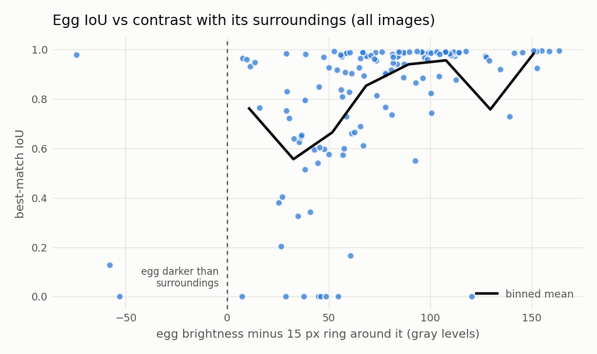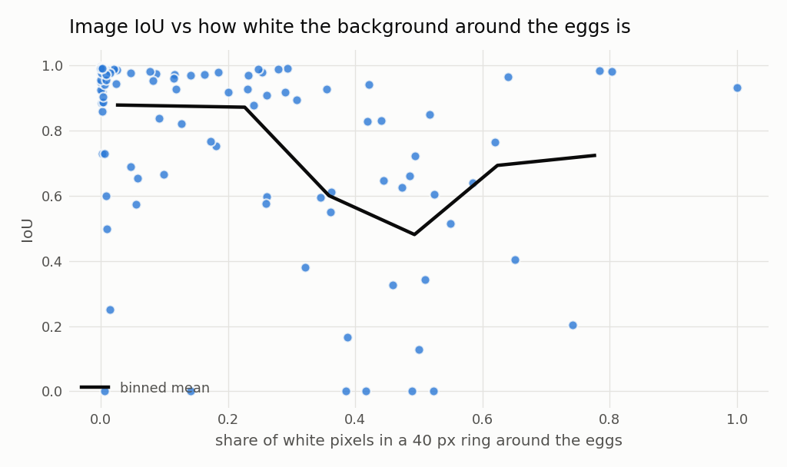

## 3.4 Qualitative analysis: what went wrong
In each gallery, the left of every pair is the image with the SAM outline (magenta). The right is the error map:
green = correct, red = false positive, blue = missed.

**Under-segmented.** The prediction stops at the **line between the lit and shadowed sides of the egg**. Under
one-sided light a white egg has two very different brightness levels. At every sweep threshold the two halves are
separate blobs, and the lit half alone is already a good ellipse, so it wins. GrabCut then can't cross into the
shadowed half, because its colour model learned "egg = bright".

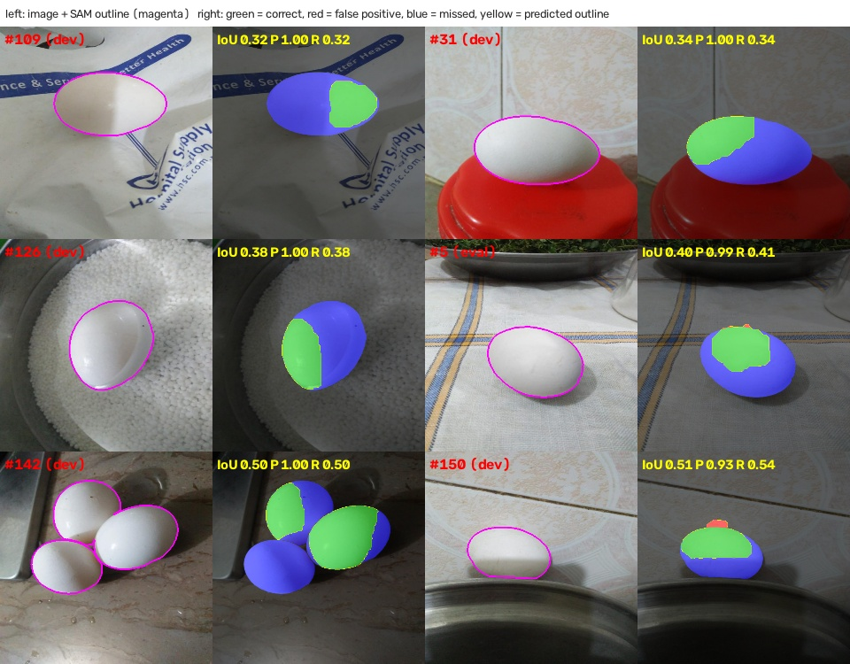

**Missed / wrong object.** The causes:

- **White egg on a white bag** (#106, #125): no threshold isolates the egg, and the forced single egg lands on a
    patch of bag.
- **Occlusion** (#11, #117): a twig or rod cuts the egg into pieces that aren't egg-shaped on their own.
- **A close-up held egg** (#44) that merges with the bright background.
- **An egg cut by the frame edge** (#139).

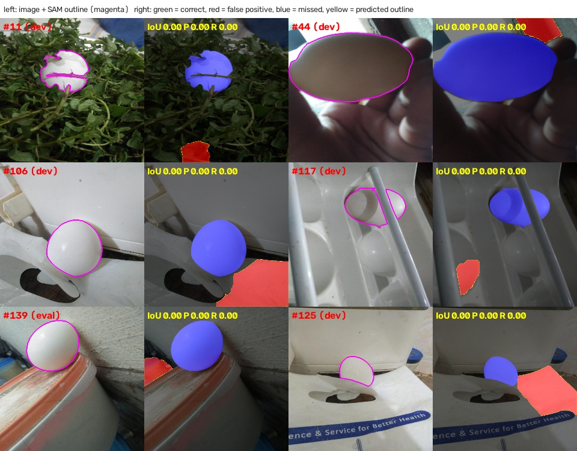

**Leak.** The egg is found, but the mask takes in some background:

- **#20:** a backlit egg plus the hand holding it.
- **#27, #78:** ash-covered eggs, where GrabCut spreads into the ash heap.
- **#159:** reflections on steel.

Backlighting alone isn't fatal: #24 is backlit and scores 0.98.

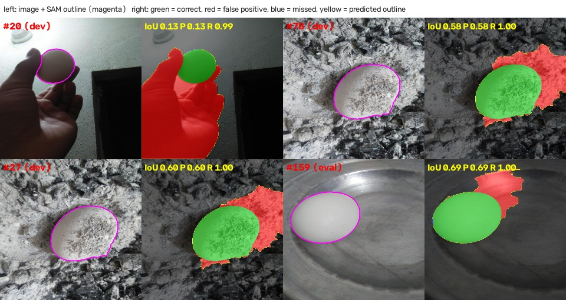

## 3.5 Performance gaps and potential improvements
| Gap | Evidence | Improvement |
|---|---|---|
| Lit/shadow split | 38% of lost IoU | Ellipse completion from edge-supported outline points (tried in 3.6), or shading-invariant chromaticity |
| Low contrast, white on white | IoU 0.56 at contrast < 50 | Use the egg's own shadow as a cue, or a gradient-based ellipse detector (randomized Hough) independent of region thresholds |
| Occlusion | #11, #117 | RANSAC ellipse over several nearby egg-coloured pieces |
| Forced pick lands on background | #106, #125, #139 | Keep the rule (t14: −0.17 without it), but choose the forced pick with a stricter shape test |
| Leaks into skin, ash, reflections | #20, #27, #78, #159 | Skin-colour model as GrabCut background seeds; a specular-reflection test |
| Boundary accuracy | boundary F1 0.63–0.70 | Active contours fitted to the image gradient |

## 3.6 A follow-up after the frozen evaluation: ellipse completion (v2)
**Diagnosis (dev only).** On the lit/shadow cut, only **4%** of the outline points lie on a Canny edge, against 25% of
the real outline.

**v2.** Before GrabCut, an ellipse is fitted to the outline points that are strong edges *for that blob* (gradient
≥ 0.3 × the 90th percentile along its own outline) and added to the blob, with guards on growth, aspect,
containment and colour.

- **Fixed Canny thresholds failed** (t17a): the whole outline is faint on pale backgrounds.
- **Dev: 0.786 → 0.809** mIoU, boundary F1 0.699 → 0.732.

**Eval, run once: 0.786 vs v1's 0.789.**

- **It helps the 3 eval scenes with lit/shadow splits:** green door 0.82 → 0.89, cloth 0.63 → 0.65, tub
    0.77 → 0.78.
- **It hurts the steel pot** (0.86 → 0.83): the ellipse extends onto colourless reflections and bubbles in the
    water next to the egg.

Dev had no such scene. **v1 remains the submitted model.** Tuning v2 on the steel-pot images would mean designing
on eval. This is also why the scene-grouped split mattered: with a random split, steel-pot images would have been
in dev, the problem would have been tuned away unnoticed, and eval would have flattered the method.

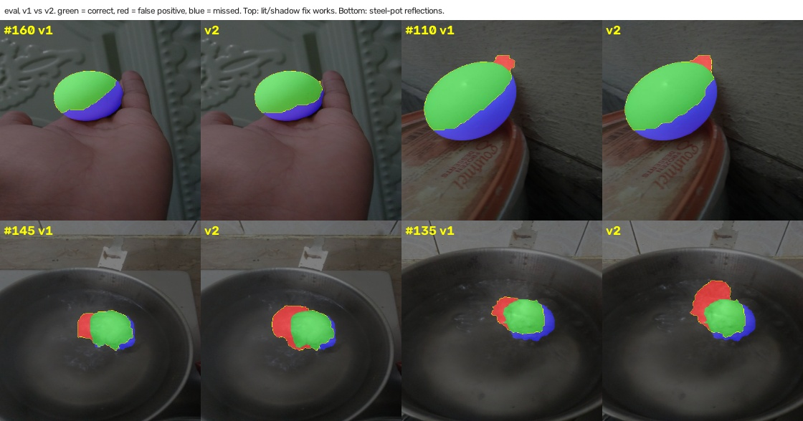

# Task 4: Video tracking
**Video:** "Raw and Boiled Egg Spinning", 60 s, 24 fps. The 10–42 s part shows two white eggs on a glossy table that
are spun, **picked up, carried and put down** by a hand; the rest is title cards. Output video: {{DRIVE_LINK}}.

## 4.1 Detection
The v1 algorithm runs on every frame, in parallel across CPU cores, at 640 px wide. Its pixel parameters were tuned
at that scale, and the output is drawn at the original resolution (the run used a 1080p copy). Two settings change
for video (`configs/video_v1.yaml`):

- **Smaller size limits:** eggs cover about 0.5% of a frame, against 2.6–38% in the dataset.
- **No forced egg,** so the title cards stay empty.

On sampled frames it detected both eggs and nothing on the text overlays or the logo. The only false detections
were an occasional tiny speck or an egg merged with the table below it into one blob; the tracker filters those (no
new track from a duplicate or from the reflection zone under an egg). While an egg is held, its outline is broken up
by fingers and it is **not detected**.

## 4.2 Tracker ([`src/track_video.py`](https://github.com/Duggineniakhil/Egg_Segmentation/blob/main/src/track_video.py))
- **Visible egg:**
    - A Kalman filter (x, y, vx, vy) predicts the next position.
    - Detections are matched with **Hungarian assignment** (independent of detection order) on centroid distance
        minus box IoU.
    - Matches are limited by the egg's typical size (median of recent detections), its vertical movement (eggs slide
        sideways in the image; a jump straight down is the reflection) and its area.
    - New tracks are confirmed after 3 hits.
- **Hidden or held egg: the track is kept.** Each frame, its estimate is moved by the **optical flow** (pyramidal
    Lucas–Kanade, forward-backward checked) of whatever covers it. Under a hand that is the hand's motion, so the
    estimate is carried along. The estimate then locks onto the **visible white part of the held egg** (a compact
    egg-white blob near the estimate; blobs are shared out one-to-one between hidden eggs).
- **Recovery:** a reappearing egg is matched to the **propagated** estimate, only if it's a whole egg, and never if
    it's another egg or a reflection. New IDs are only issued when no hidden egg can explain the detection.
- **Dropping tracks:** only at a scene change, when an egg leaves the frame, or after 30 s hidden.
- **Logging:** every new ID, miss and recovery (with distance and confidence) goes to `tracking_log.csv`.
- **Display:** a visible egg is drawn with its mask and "Egg N". A hidden or held egg gets the same "Egg N" label
    (no "hidden" text) on a dashed box at its *estimated* position. The dashed box means the position is estimated,
    not detected. How well that estimate follows the held egg is measured in 4.5.

## 4.3 The ID switch at 30 s: root cause and fix
**What happens in the video.** Frame-by-frame viewing showed that at 30 s one hand holds egg A at the far left and
grabs egg B with its outer fingers. It leaves A on the table and carries B to the right.

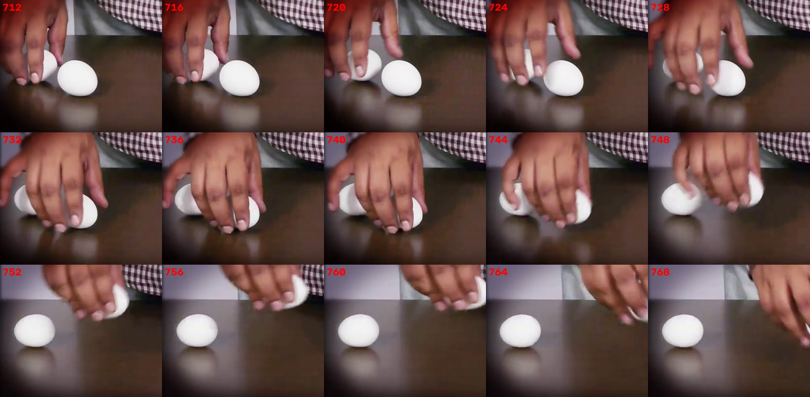

Frames 712–768: the hand holds A (left), grabs B, leaves A at the far left and carries B away.

**Root causes in the first tracker:**

1. **Held eggs are never detected.**
2. **A hidden egg's estimate stayed where it was last seen,** with a damped Kalman prediction. A was carried across
    the frame while its estimate sat on the right.

3. **Reappearing eggs were given the ID of the nearest *stale* position,** greedily. A reappeared at the far left,
    nearest to B's old spot, and B reappeared near A's old spot. **The IDs swapped.**

4. **Tracks were dropped after 2 s hidden.**
5. **Hidden eggs could be recovered onto the reflection** under an egg.

**The fix** is the hidden-egg handling above: estimates follow the hand, recovery uses the propagated estimates,
and reflections can't recover a track.

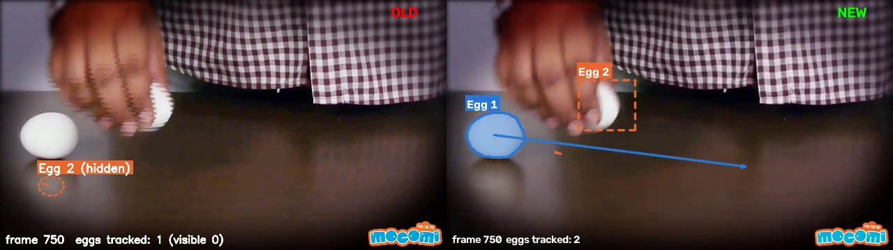

Frame 750, old (left) vs new (right). Old: "Egg 2" is on the wrong egg and the hidden label is stranded. New: each ID stays on its own egg, and Egg 2 is followed in the hand.

## 4.4 Quantitative evaluation
**Ground truth.** Grounding DINO + SAM (as in Task 1) on **every 4th frame** of the egg scene (196 frames). It is
independent of the classical detector. Identities were assigned from the frame-by-frame account and checked on
review sheets, giving 365 egg instances, 41 of them held.

**Metrics** (`src/eval_tracking.py`): centroid matching normalized by the ground-truth box diagonal (< 0.5), then
MOTA, IDF1 and ID switches. False positives are only counted in frames where SAM found both eggs.

| Tracker | MOTA | IDF1 | ID switches | frames with wrong ID | held eggs followed | held-egg IDF1 |
|---|---|---|---|---|---|---|
| **final (`tracked_eggs.mp4`)** | **0.962** | **0.953** | **0** | **0** | **85%** | **0.921** |
| first version | 0.882 | 0.620 | 2 | 109 (from frame 754) | 32% | 0.481 |

**Identity:** zero ID switches were observed across the 196 sampled evaluation frames, and no sampled frame shows an
egg with the other egg's ID. Identity continuity was also inspected frame by frame:

- `src/check_tracks.py` checks every frame in six segments before and after the 30 s handover (frames 230–470,
    570–700, 760–990) against hand-written egg positions.
- The annotated video and debug frames were checked visually at every pick-up and the handover.

These per-frame checks found no switch either, but they are a different kind of evidence from the sampled metrics.

**The 8 sampled misses:**

- **Frame 222:** the first frame of the scene, before the 3-hit confirmation.
- **Frames 534–554** (6 frames, about 1 s; see 4.5).

## 4.5 Held eggs in the output video
The video shows no "(hidden)" labels. Each held stretch was checked against `tracks.csv` and the frames below:

| Egg | held stretch (frames) | estimate travel | longest stationary run | estimate locked onto the egg's white |
|---|---|---|---|---|
| Egg 1 | 476–556 | 543 px | 7 frames (0.3 s) | 44 of 81 frames |
| Egg 1 | 647–748 | 678 px | 7 frames | 83 of 102 frames |
| Egg 2 | 728–809 | 446 px | 4 frames | 61 of 82 frames |

So the box moves with the hand rather than standing where the egg was last seen. In the frames where it isn't
locked onto the egg's white, it is moved by optical flow alone.

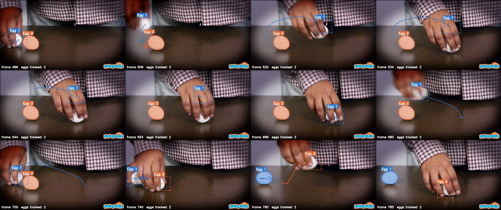

Frames 486–785 of the 1080p output (dashed box = estimated position of a held egg). The box is on the egg in the hand at 486, 506, 520, 668, 680, 700, 740, 760 and 785. At 534–554 it sits on the back of the hand above Egg 1.

**Measured on the sampled ground truth:** 35 of 41 held-egg frames (85%) have the estimate within half an egg
diagonal of the true egg, with a mean error of 0.07 diagonals, and the ID is correct in all of them.

**The 6 misses (frames 534–554) are one failure.** As the hand lowers Egg 1 to the table:

- the fingers cover the top of the egg, and only a sliver of white shows below them;
- the estimate follows the hand's knuckles by optical flow, about **105 px (one egg diagonal, about 1.5 egg heights)
    directly above the egg**. Horizontally it is right, within 13 px.
- the egg's visible white is just outside the radius in which the estimate may lock onto it. Widening that radius
    was tried: the estimate then locked onto the shirt's white checks and the wall, so it was kept.

For about a second the label is near the egg but on the hand, not on the egg. The ID stays correct, and the egg is
recovered exactly when it is put down (frame 557).

**Not measured:** while an egg is lifted high near the shirt (frames 506–530 and 670–686), SAM didn't find it either,
so those frames have no ground truth and were checked only by eye. The box is on the egg in the sampled frames
above. A smaller artifact: at frame 506, Egg 2's mask briefly includes a sliver next to the egg passing in the hand.

**Limitations:**

- **The ground truth is SAM plus my own identity labels.**
- **The quantitative evaluation samples every 4th frame;** the per-frame checks above are separate.
- **The eggs are identical,** so identity rests on motion continuity. A fully hidden egg moving without anything
    visible would only be a best guess; the tracker flags such recoveries as `low_confidence`, and none occurred.

<!-- Use of AI tools: add your section here (then run: python src/build_report.py ...) -->
